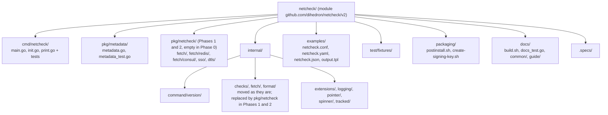

# Restructure `netcheck` to Match `ligo` and `lxd-spiffe`

| | |
| :-- | :-- |
| Status | Draft 0.3 (2026-11-17). Drafted 2026-11-12 as a plain restructure of the command; revised for the library (`netcheck-library.md`). Not approved |
| Scope | **Phase 0 only** of the delivery plan in `netcheck-library.md` §9: repository layout, module path, tooling, CI, documentation pipeline. The code moves with the fixes D-1 and D-16 and no other behaviour change. The library itself (`pkg/netcheck` and its sub-packages) is Phases 1 and 2 |
| Companions | `netcheck-reverse-engineering.md` (defects D-n), `netcheck-library.md` (target API, decisions L-1 to L-5) |
| History | `implementation_plan.md`, an earlier copy of this plan with absolute file links, was removed: its content is this file |

## Goal Description

Restructure `netcheck` to follow the repository layout, build/release pipeline, linting/security gates, CI workflows, and documentation pipeline established in `ligo` and `lxd-spiffe`:

- **Module path:** `github.com/dihedron/netcheck/v2` (decision L-5: the library is released as `v2.0.0`). `go.mod`, every import, the linker flags in `Makefile`/`.goreleaser.yaml` and `pkg/metadata` follow the new path.
- **Go package layout**: Move the entrypoint to `cmd/netcheck`, public build metadata to `pkg/metadata`, private packages to `internal/`, and add `internal/command/version`.
- **CLI compatibility**: Preserve flat CLI invocation (`netcheck [flags] [bundles...]`) while delegating `netcheck version [-v|--verbose] [-D|--dotenv]` to `internal/command/version.Run`.
- **Configuration, examples, and test fixtures**: Move `netcheck.conf` to `examples/netcheck.conf`, move `_test/*` to `test/fixtures/`, move `postinstall.sh` to `packaging/postinstall.sh`, add `packaging/create-signing-key.sh`, and delete the outdated `Dockerfile`.
- **Build, lint, security, and release tooling**: Align `Makefile`, `go.mk`, `custom.mk`, `.goreleaser.yaml`, `.golangci.yml`, `.gitleaks.toml`, `.trufflehog-exclude`, `codecov.yml`, `sonar-project.properties`, `.gitignore`, `.vscode/settings.json`, `LICENSE`, and `.github/workflows/{ci,codeql,docs,release}.yml` with `ligo` and `lxd-spiffe`.
- **Documentation (`docs/`)**: Add the containerized Pandoc/Eisvogel + Mermaid PDF build pipeline (`docs/build.sh`, `docs/common/`, `docs/guide/`, `docs/docs_test.go`) producing a single comprehensive guide (`netcheck-guide-<version>.pdf`) covering product overview, architecture, installation, writing check bundles (all check types), publishing bundles, and running `netcheck` against local, HTTP(S), Redis, and Consul sources. In Phase 0 the guide documents the command as it behaves after the D-1 and D-16 fixes; the library chapters and the exit-status table are added in Phase 3.

---

## Architecture & Directory Layout

---

## Findings carried over

The companion spec lists the defects in full (D-1 to D-17); the two below were found first and are fixed in the move.

> **D-1: `checks/bundle.go`, reversed `HasPrefix`**
> Lines 36–37 and 44 of `checks/bundle.go` currently pass arguments to `strings.HasPrefix` in reversed order (`strings.HasPrefix("http://", path)` instead of `strings.HasPrefix(path, "http://")`), preventing HTTP(S) and Redis URL prefix detection in `checks.New`. We will fix the argument order (`strings.HasPrefix(path, ...)`) as part of moving `checks` to `internal/checks`.

> **D-16: `fetch` tests are not self-contained**
> `fetch/http_test.go` currently fails on a clean checkout because it expects untracked `fetch/server.crt` and `fetch/server.key` files on disk. We will generate an ephemeral self-signed certificate in `t.TempDir()` inside `http_test.go` so `go test ./...` passes everywhere without external setup.

---

## Proposed Changes

### 1. Specification (`.specs/`)

The three specs of this branch are the record required by AGENTS.md rule 1: `netcheck-reverse-engineering.md`, `netcheck-library.md` and this file. They move with the first commit.

---

### 2. Public Metadata Package (`pkg/metadata/`)

#### [NEW] `pkg/metadata/metadata.go`
#### [NEW] `pkg/metadata/metadata_test.go`
#### [DELETE] `metadata/metadata.go`
- Move `metadata` to `pkg/metadata` matching `ligo/pkg/metadata/metadata.go`.
- Fix `PrintFull(writer io.Writer)` to write to `writer` via `_, _ = fmt.Fprintf(writer, ...)` instead of `fmt.Printf`, remove the duplicate `Git Time` line, and include `LoadDotEnv(filename string) error` (which avoids leaking malformed `.env` contents in error strings).
- Add unit tests in `pkg/metadata/metadata_test.go` covering `Print`, `PrintFull`, and `LoadDotEnv`.

---

### 3. Internal Packages (`internal/`)

The moved packages `internal/checks`, `internal/fetch` and `internal/format` are **transitional**: Phase 1 and Phase 2 replace them with `pkg/netcheck` and its sub-packages and delete them. Moving them first keeps this PR reviewable as a pure restructure, and keeps the command working throughout. Import paths below carry the `/v2` module suffix, e.g. `github.com/dihedron/netcheck/v2/internal/checks`.

#### [NEW] `internal/command/version/command.go`
#### [NEW] `internal/command/version/command_test.go`
- Add `version.Version` and `version.Run(args []string) int` matching `ligo/internal/command/version/command.go`, reading `NETCHECK_DOTENV` (`-D`/`--dotenv`) and masking secret-bearing `NETCHECK_*` environment variables in verbose mode (`-v`/`--verbose`).

#### [MOVE] `checks/` → `internal/checks/`
#### [MOVE] `extensions/` → `internal/extensions/`
#### [MOVE] `fetch/` → `internal/fetch/`
#### [MOVE] `format/` → `internal/format/`
#### [MOVE] `logging/` → `internal/logging/`
#### [MOVE] `pointer/` → `internal/pointer/`
#### [MOVE] `spinner/` → `internal/spinner/`
#### [MOVE] `tracked/` → `internal/tracked/`
- Update all import paths from `github.com/dihedron/netcheck/<pkg>` to `github.com/dihedron/netcheck/v2/internal/<pkg>`.
- Fix `strings.HasPrefix(path, ...)` argument order in `internal/checks/bundle.go`.
- Update fixture paths in `internal/fetch/*_test.go` to `../../test/fixtures/...` and generate a temporary self-signed TLS cert in `internal/fetch/http_test.go`.
- Fix `golangci-lint` findings (`errcheck` on `defer conn.Close()` / `resp.Body.Close()`, `staticcheck` QF1008 embedded selector in `internal/fetch/http.go`, and documented `//nolint:gosec` on intentional SSH host-key ignore in `internal/checks/check.go` connectivity probe).

---

### 4. Application Entrypoint (`cmd/netcheck/`)

#### [NEW] `cmd/netcheck/main.go`
#### [NEW] `cmd/netcheck/init.go`
#### [NEW] `cmd/netcheck/print.go`
#### [NEW] `cmd/netcheck/main_test.go`
#### [NEW] `cmd/netcheck/init_test.go`
#### [DELETE] `main.go`
#### [DELETE] `init.go`
#### [DELETE] `print.go`
- Move `main.go`, `init.go`, and `print.go` into `cmd/netcheck/`.
- Structure `main()` to call `os.Exit(run())` with `defer cleanup()` inside `run() int` (matching `ligo/cmd/ligo/main.go`).
- Handle `netcheck version [-v|--verbose] [-D|--dotenv ...]` via `version.Run(os.Args[2:])` and `--version` via `metadata.Print(os.Stdout)`, while keeping flat flag parsing (`-f`/`--format`, `-t`/`--template`, `--print-diagnostics`, positional bundle arguments) for check execution.
- Align `cmd/netcheck/init.go` with `ligo/cmd/ligo/init.go` (`metadata.LoadDotEnv`, `closeProfile` helper, `NETCHECK_LOG_LEVEL`, `NETCHECK_LOG_STREAM`, `NETCHECK_CPU_PROFILE`, `NETCHECK_MEM_PROFILE`).

---

### 5. Examples, Test Fixtures, Packaging, and Root Cleanup

#### [NEW] `examples/netcheck.conf`, `examples/netcheck.yaml`, `examples/netcheck.json`, `examples/output.tpl`
#### [NEW] `test/fixtures/netcheck.yaml`, `test/fixtures/netcheck.json`, `test/fixtures/output.tpl`
#### [NEW] `packaging/postinstall.sh`
#### [NEW] `packaging/create-signing-key.sh`
#### [DELETE] `netcheck.conf`, `postinstall.sh`, `Dockerfile`, `_test/`
- Move `netcheck.conf` to `examples/netcheck.conf` and copy sample bundles/template to `examples/` and `test/fixtures/`.
- Move `postinstall.sh` to `packaging/postinstall.sh` and add `packaging/create-signing-key.sh` configured for `netcheck`.
- Remove `_test/` and `Dockerfile`.

---

### 6. Documentation Pipeline (`docs/`)

#### [NEW] `docs/build.sh`
#### [NEW] `docs/docs_test.go`
#### [NEW] `docs/common/` (`defaults.yaml`, `front-matter.md`, `mermaid.json`, `filters/*.lua`, `artwork/logo.png`, `diagrams/architecture.md`)
#### [NEW] `docs/guide/` (`metadata.yaml`, `01-introduction.md`, `02-architecture.md`, `03-installation.md`, `04-writing-bundles.md`, `05-publishing-bundles.md`, `06-running-netcheck.md`)
- Copy shared Pandoc/Eisvogel filters, Mermaid config, and build script pattern from `lxd-spiffe/docs`, configured for a single document (`DOCUMENTS=(guide)`, producing `build/docs/netcheck-guide-<version>.pdf`).
- Write chapters in `docs/guide/`:
  1. `01-introduction.md` — What `netcheck` does and use cases.
  2. `02-architecture.md` — Architecture, bundle fetchers, worker-pool execution, output renderers, and template field-access tracking (with Mermaid diagram).
  3. `03-installation.md` — Installing from packages (DEB/RPM/APK) or archives, verifying signatures/checksums, `cap_net_raw` for ICMP, and `netcheck.conf` defaults.
  4. `04-writing-bundles.md` — Bundle schema (YAML/JSON), defaults/overrides (`timeout`, `retries`, `wait`, `concurrency`), and every check protocol (`tcp`, `udp`, `icmp`, `tls`, `dtls`, `ssh`, `http`, `https` + `sso`).
  5. `05-publishing-bundles.md` — Publishing bundles as local files, on HTTP(S) servers (`Content-Type` requirements), in Redis keys, in Consul KV, and in Consul Service Registry metadata.
  6. `06-running-netcheck.md` — Running `netcheck` against each source scheme (`http://`, `https://`, `https-://`, `http+sso://`, `https+sso://`, `https+sso-://`, `redis://`, `rediss://`, `rediss-://`, `consulkv://`, `consulkvs://`, `consulkvs-://`, `consulsr://`, `consulsrs://`, `consulsrs-://`), output formats (`text`, `json`, `yaml`, `template`), template debugging (`--print-diagnostics`), and logging/profiling environment variables.
- Add `docs/docs_test.go` to verify table column widths and sample validity.

---

### 7. Build, Lint, Security, and CI Configuration

#### [MODIFY] `go.mod`
- `module github.com/dihedron/netcheck/v2`; run `go mod tidy`. The `Makefile`'s `_APPLICATION_METADATA_PACKAGE`, derived from the `module` line, then carries `/v2` by itself, which is what the linker flags need.

#### [MODIFY] `Makefile`
- Set `_APPLICATION_METADATA_PACKAGE=$$(grep "module .*" go.mod | sed 's/module //gi')/pkg/metadata`, `_APPLICATION_DOTENV_VAR_NAME=NETCHECK_DOTENV`, `_APPLICATION_LICENSE := AGPLv3`, `_APPLICATION_COPYRIGHT := 2025-2026 © Andrea Funtò`.

#### [MODIFY] `go.mk`
- Sync with `ligo/go.mk` (`_GO_MK_COMMA`, conditional `sign` skip in `go-snapshot` when `GPG_FINGERPRINT` is unset, `go-quality` cleanup).

#### [MODIFY] `custom.mk`
- Align targets with `ligo/custom.mk` and `lxd-spiffe/custom.mk`:
  - `lint` (`gofmt -l cmd internal pkg docs`, `go vet ./...`, `golangci-lint run ./...`)
  - `compile: lint go-dev`
  - `snapshot: signing-check lint go-snapshot`
  - `release: signing-check lint` (runs `docs/build.sh` then `go-release`)
  - `docs`, `signing-check`, `clean`, `fuzz`, `scanners`, `secrets`, `vuln` (`-C cmd/netcheck -scan module` and `./...`).

#### [MODIFY] `.goreleaser.yaml`
- Point `builds[0].main` to `./cmd/netcheck` and `Name={{.ArtifactName}}`.
- Align `archives`, `nfpms` (`license: "AGPL-3.0"`, `examples/netcheck.conf` → `/etc/netcheck.conf`, `packaging/postinstall.sh`, RPM/DEB GPG signature blocks), `source`, `sboms` (`${artifact}.cdx.json`), `checksum` (including `./build/docs/*.pdf`), `signs`, and `release` with `ligo` / `lxd-spiffe`.

#### [NEW] `.golangci.yml`, `.gitleaks.toml`, `.trufflehog-exclude`, `codecov.yml`, `sonar-project.properties`, `.vscode/settings.json`
#### [MODIFY] `.gitignore`, `LICENSE`, `README.md`
#### [MODIFY] `.github/workflows/ci.yml`, `.github/workflows/codeql.yml`, `.github/workflows/release.yml`
#### [NEW] `.github/workflows/docs.yml`
#### [DELETE] `.github/workflows/dependency-review.yml`, `.github/workflows/gitleaks.yml`, `.github/workflows/trufflehog.yml`
- Replace the fragmented workflows with the unified `ci.yml` (Build & test + Codecov + SonarQube, Secret scans, Dependency review), `codeql.yml`, `docs.yml`, and `release.yml` from `ligo`/`lxd-spiffe`.
- Replace the truncated `LICENSE` with the full GNU AGPLv3 license text from `ligo/LICENSE`.
- Update `README.md` paths (`examples/` instead of `_test/`).

---

## Verification Plan

### Automated Tests
0. `grep -rn 'dihedron/netcheck/' --include=*.go . | grep -v '/v2'` returns nothing, and `./dist/.../netcheck version -v` shows the build metadata (the linker flag hits the `/v2` path).
1. `go test -v -race ./...` — Verify all unit tests in `cmd/netcheck`, `pkg/metadata`, `internal/...`, and `docs` pass.
2. `make lint` — Verify `gofmt`, `go vet`, and `golangci-lint` pass with zero issues.
3. `make compile` — Verify `goreleaser build --single-target` succeeds and outputs `dist/netcheck_linux_amd64_v1/netcheck`.
4. `./dist/netcheck_linux_amd64_v1/netcheck version -v` and `./dist/netcheck_linux_amd64_v1/netcheck --template=examples/output.tpl --print-diagnostics` — Verify binary execution.
5. `make vuln` — Verify `govulncheck` reports no vulnerabilities.
6. `make docs` (if Docker/Podman is available) — Verify `build/docs/netcheck-guide-*.pdf` builds cleanly.
